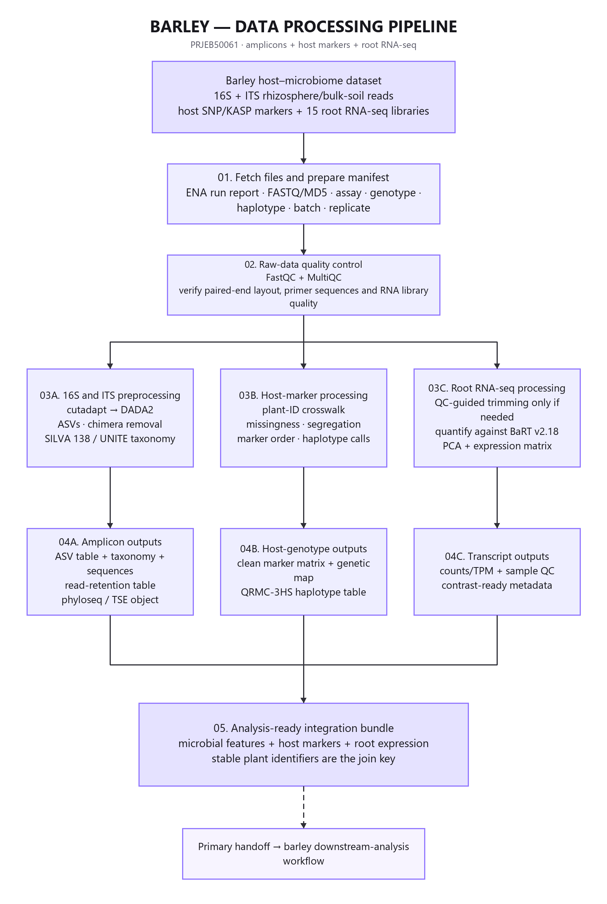
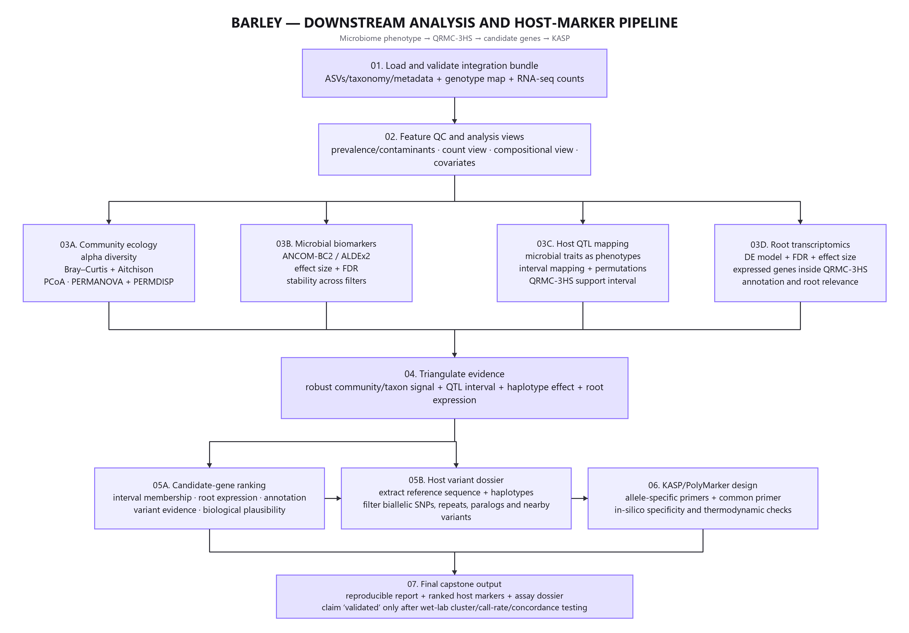
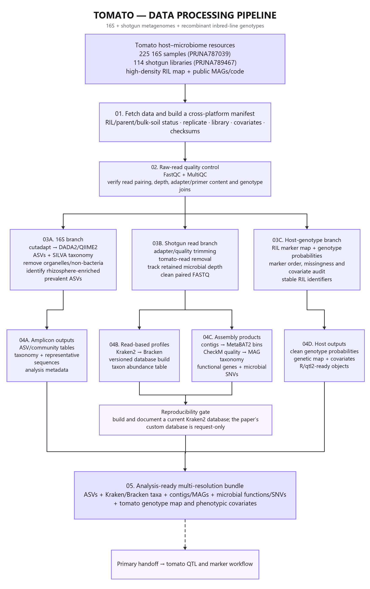
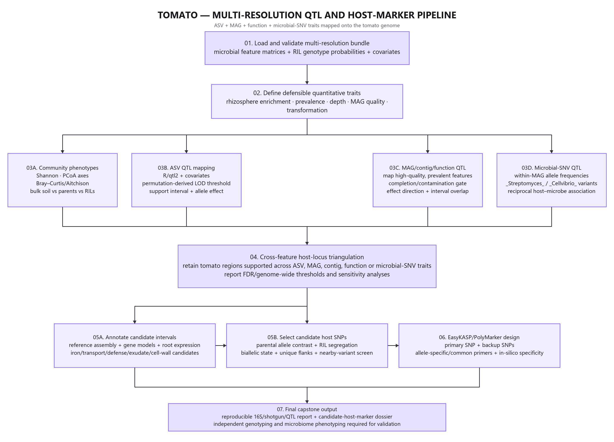
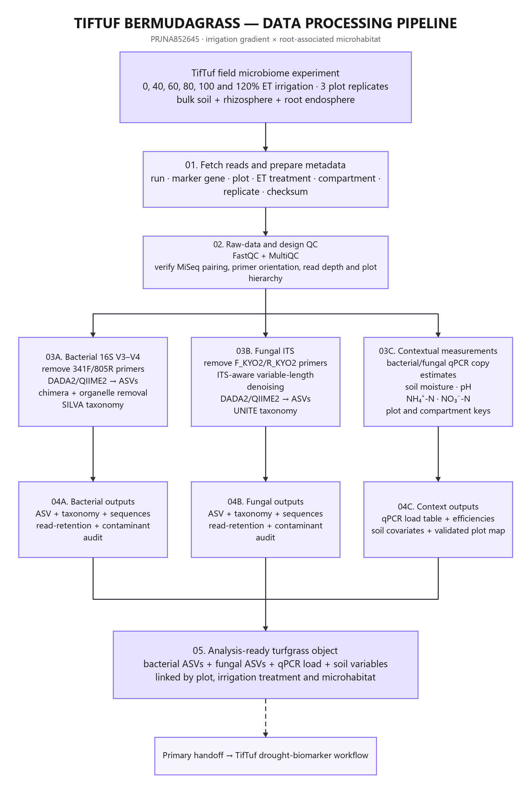
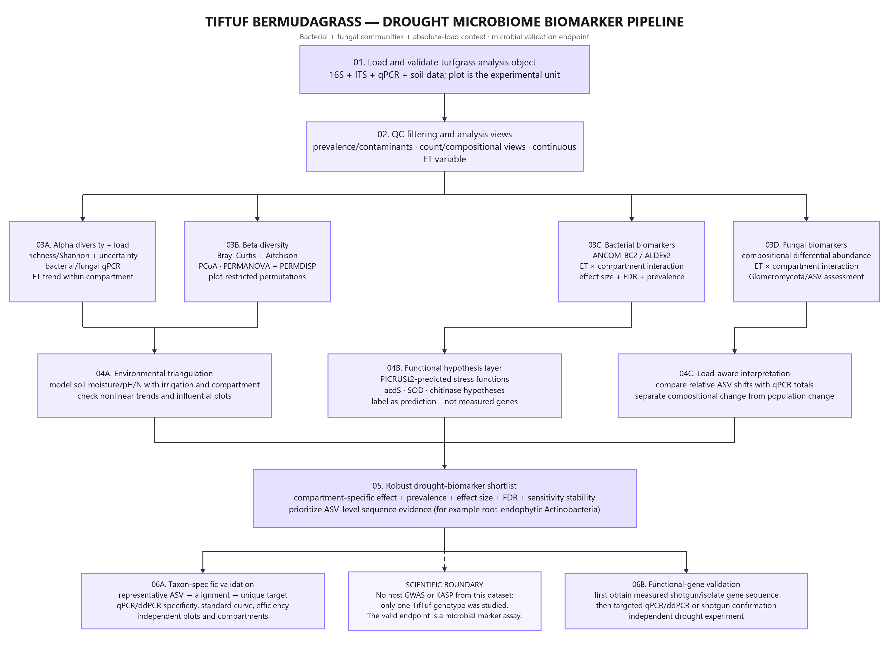

# Study-specific plant microbiome pipelines

Each study has two figures modeled on the supplied reference diagrams:

1. a **data-processing pipeline** from public data and metadata to an analysis-ready object;
2. a **downstream-analysis pipeline** from quality-controlled features to the correct marker and validation endpoint.

## Barley

The endpoint is a barley host SNP/haplotype and an in-silico KASP/PolyMarker assay dossier. A marker should be called validated only after laboratory genotype-cluster, call-rate, concordance, and independent-population testing.

## Tomato

The design integrates 16S ASVs, shotgun taxonomic profiles, contigs/MAGs, microbial functions or SNVs, and the tomato recombinant inbred-line genotype map. The endpoint is a candidate tomato host variant and KASP/PolyMarker design.

## TifTuf bermudagrass

The endpoint is a microbial taxon- or gene-specific qPCR/ddPCR validation strategy. Host QTL/GWAS or KASP discovery is not supported because the study used one TifTuf genotype.

## Figure inventory

- `01_barley_data_pipeline.png` — 1600 × 2380 px
- `02_barley_analysis_pipeline.png` — 2800 × 1950 px
- `03_tomato_data_pipeline.png` — 1700 × 2700 px
- `04_tomato_analysis_pipeline.png` — 2850 × 2050 px
- `05_tiftuf_data_pipeline.png` — 1600 × 2380 px
- `06_tiftuf_analysis_pipeline.png` — 2850 × 2100 px

The reproducible generator is located at `work/generate_study_pipeline_diagrams.py`.
