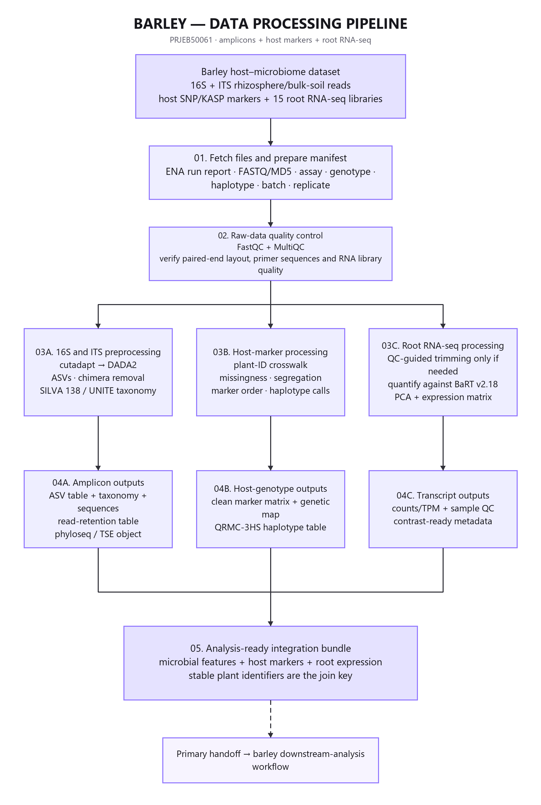
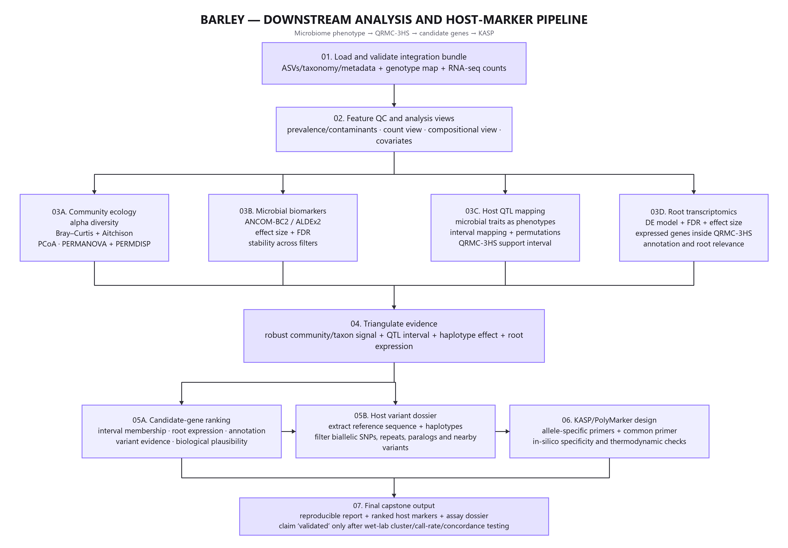
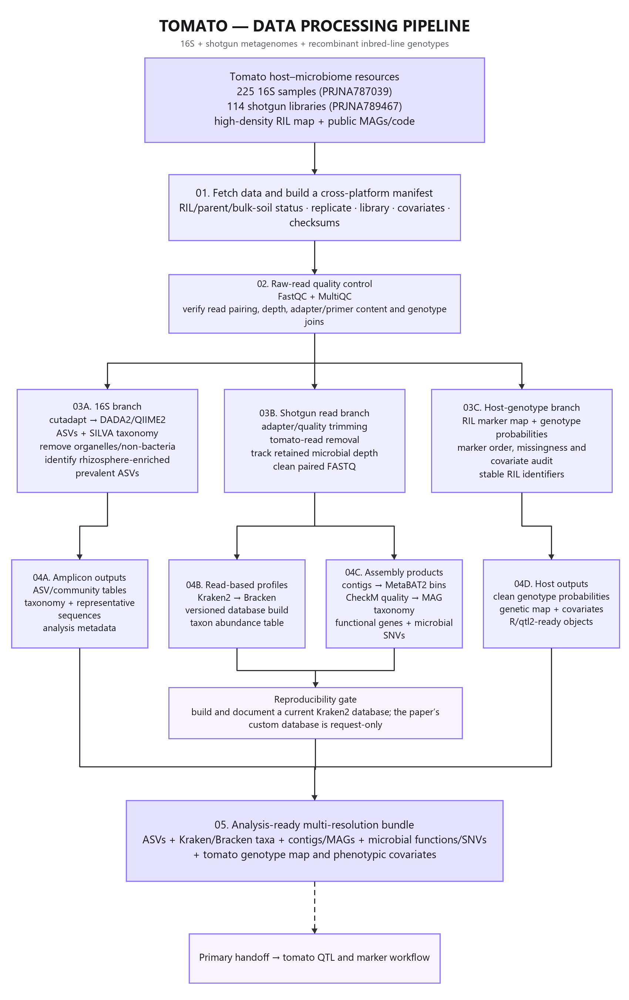
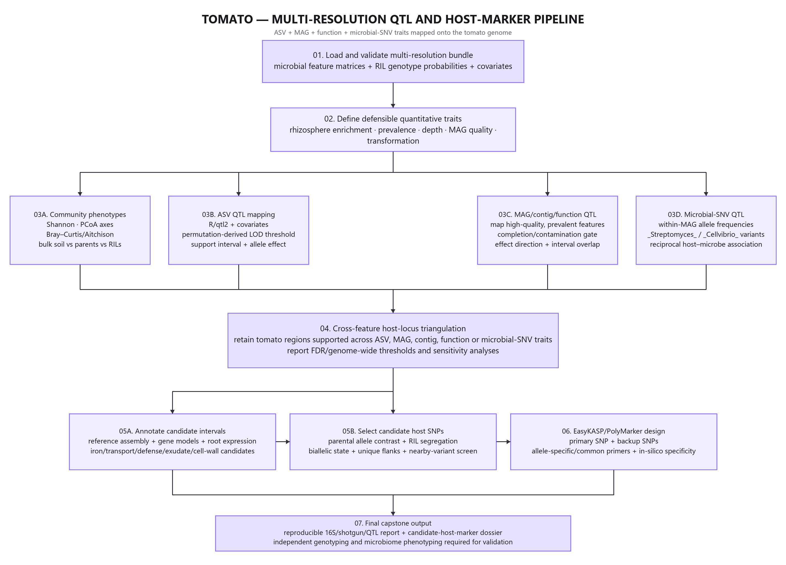
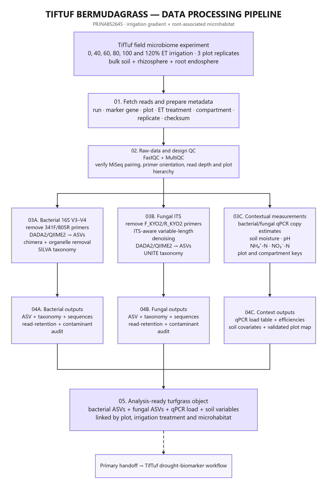
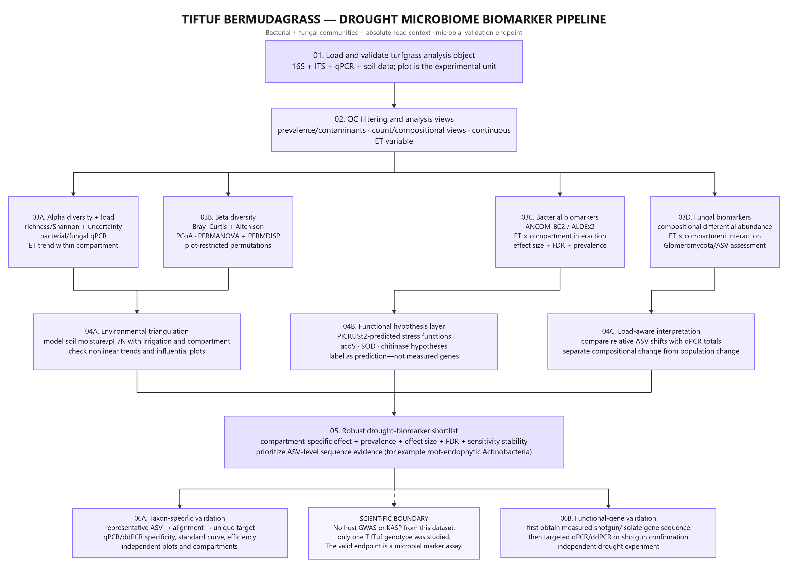

# Plant Microbiome and Marker Identification Capstone Portfolio

## Three reproducible studies in barley tomato and TifTuf bermudagrass

Prepared as a teaching and supervision guide for advanced undergraduate and MSc capstone projects  
September 2026

## Purpose and recommended use

This portfolio organizes three public plant microbiome studies into complementary student capstones. Together, the projects teach raw sequence quality control, bacterial and fungal amplicon analysis, shotgun metagenomics, microbial biomarker discovery, host quantitative trait locus analysis, transcriptomics, candidate gene prioritization, and targeted marker design.

The recommended allocation is one study per student. Barley provides the clearest route from a host microbiome QTL through root expression to a candidate host KASP assay. Tomato adds shotgun metagenomics, metagenome assembled genomes, microbial sequence variation, and a second host QTL system. TifTuf bermudagrass supplies a genuine turfgrass application with an irrigation gradient, three root associated compartments, bacterial and fungal profiles, and quantitative PCR measurements of microbial load.

The three projects share one reproducibility standard, but they do not share the same validation endpoint. Barley and tomato can support in silico design of host KASP assays after a defensible plant SNP has been identified. The TifTuf dataset contains one host genotype, so its valid endpoint is a taxon or microbial gene assay using qPCR, ddPCR, targeted sequencing, or cultivation.

## Document map

1. Portfolio design and scientific boundaries
2. Shared analysis and reproducibility standards
3. Barley host microbiome capstone
4. Tomato multi resolution host microbiome capstone
5. TifTuf bermudagrass drought microbiome capstone
6. Coordinated delivery schedule and assessment
7. Risks limitations and future validation
8. Public data software and references
9. Technical appendices

# 1 Portfolio design and scientific boundaries

## 1.1 Selected studies

| Study | Primary paper | Public data | Main analytical contribution | Correct marker endpoint |
|---|---|---|---|---|
| Barley | Escudero-Martinez et al. 2022 Identifying plant genes shaping microbiota composition in the barley rhizosphere | ENA PRJEB50061 and Zenodo 10.5281/zenodo.6584148 | 16S and ITS microbiomes host markers QRMC-3HS and root RNA-seq | Candidate barley SNP or haplotype followed by KASP or PolyMarker design |
| Tomato | Oyserman et al. 2022 Disentangling the genetic basis of rhizosphere microbiome assembly in tomato | PRJNA787039 PRJNA789467 and Zenodo 10.5281/zenodo.6561541 | 16S shotgun Kraken MAGs microbial SNVs and host QTL mapping | Candidate tomato host SNP followed by KASP or PolyMarker design |
| TifTuf bermudagrass | Hu et al. 2023 Water deficits shape the microbiome of Bermudagrass roots to be Actinobacteria rich | PRJNA852645 | 16S ITS qPCR irrigation gradient and bulk soil rhizosphere endosphere comparison | Microbial taxon or gene followed by qPCR ddPCR culture or targeted sequencing |

## 1.2 Three meanings of marker

| Marker type | Definition | Discovery analysis | Validation method |
|---|---|---|---|
| Marker gene | A conserved locus used to profile community membership such as bacterial 16S rRNA or fungal ITS | cutadapt DADA2 or QIIME2 ASV inference and taxonomic assignment | Technical controls mock communities and independent sequencing |
| Microbial biomarker | A taxon ASV microbial gene MAG or community signature associated with a plant phenotype treatment or environment | Compositional differential abundance multivariable models and sensitivity analysis | Taxon or gene specific qPCR ddPCR targeted sequencing culture or independent cohort |
| Host genetic marker | A plant SNP or haplotype associated with a microbiome phenotype | QTL or GWAS candidate interval analysis gene annotation and variant filtering | KASP PolyMarker or another host genotyping assay followed by independent genotype phenotype testing |

KASP genotypes a known biallelic DNA variant. It does not validate the abundance of a bacterium detected by 16S sequencing. Likewise, 16S and ITS are marker gene amplicon surveys, not shotgun metagenomics. Students must use these terms accurately in proposals, code, figures, and conclusions.

## 1.3 Coordinated student allocation

| Student | Biological system | Main driver | Data layers | Distinctive skill | Endpoint |
|---|---|---|---|---|---|
| 1 | Barley rhizosphere | QRMC-3HS host haplotype | 16S ITS host markers root RNA-seq | Integrating microbiome QTL and transcriptomics | Barley host KASP design dossier |
| 2 | Tomato rhizosphere | Wild x domesticated tomato genetics | 16S shotgun genotype map MAGs microbial variants | Amplicon to shotgun to QTL integration | Tomato host KASP design dossier |
| 3 | TifTuf bermudagrass | Irrigation and root compartment | 16S ITS qPCR soil variables | Turfgrass ecology and absolute versus relative abundance | Microbial qPCR validation dossier |

## 1.4 Portfolio coverage

| Required competency | Barley | Tomato | TifTuf | Portfolio status |
|---|---|---|---|---|
| Raw FASTQ and metadata audit | Yes | Yes | Yes | Complete |
| FastQC and MultiQC | Reanalysis | Reanalysis | Reanalysis | Complete |
| Bacterial 16S | Yes | Yes | Yes | Complete |
| Fungal ITS | Yes | No | Yes | Complete |
| QIIME2 or DADA2 | Yes | Yes | Yes | Complete |
| Shotgun metagenomics | No | Yes | No | Complete |
| Kraken2 and taxonomic binning | No | Yes | No | Complete |
| Assembly and MAG quality | No | Yes | No | Complete |
| Microbial functions or variants | Indirect | Direct shotgun evidence | PICRUSt2 prediction | Complete with an evidence hierarchy |
| Bulk soil rhizosphere and endosphere | Partial | Bulk soil and rhizosphere | All three | Complete |
| Environmental stress gradient | No | Limited covariates | Six irrigation levels | Complete |
| Absolute microbial load by qPCR | No | No | Yes | Complete |
| Host QTL or haplotype | Yes | Yes | No | Complete |
| Candidate gene prioritization | QTL and RNA-seq | QTL and gene content | Not supported | Complete |
| Host sequence and SNP extraction | Capstone extension | Capstone extension | Not supported | Complete |
| In silico KASP design | Appropriate | Appropriate | Not appropriate | Complete |
| Experimental validation | Optional new study | Optional new study | Optional new study | Requires new samples and facilities |

# 2 Shared analysis and reproducibility standards

## 2.1 Corrected portfolio workflow

The common workflow begins with raw sequence files and a verified sample manifest. It then separates by data type. Amplicon reads pass through primer removal, denoising, ASV inference, and taxonomic assignment. Shotgun reads require host read removal before read based taxonomic profiling or assembly. Host genotype data require marker quality control and a valid genetic map or kinship structure. Integration occurs only after each branch passes its own quality checks.

Microbial features are analyzed in R with experimental covariates, compositional methods, effect sizes, false discovery rate control, and sensitivity analyses. A microbial biomarker proceeds toward qPCR, ddPCR, cultivation, or targeted sequencing. A host association proceeds through a QTL or GWAS interval, reference gene models, haplotype or SNP filtering, and then KASP or PolyMarker design.

## 2.2 Required metadata fields

Every project must create a machine readable manifest with the following fields when available:

- study sample experiment and run accessions;
- sample title biological source and plant identifier;
- species genotype line haplotype or recombinant inbred line;
- bulk soil rhizosphere root endosphere or other microhabitat;
- treatment block batch collection date and relevant environmental covariates;
- biological replicate technical replicate and control status;
- library strategy source selection layout instrument read count and base count;
- FASTQ location file size MD5 checksum and download date;
- reference database version genome assembly version and software environment.

No project may infer sample groups from file order. Every join among microbial host genetic transcriptomic phenotype and environmental tables must be audited for one to one or one to many structure as appropriate.

## 2.3 Shared quality gates

1. **Manifest gate.** All run sample assay treatment genotype compartment batch and replicate labels reconcile with the paper and repository.
2. **Experimental unit gate.** Inference uses plants recombinant inbred lines or field plots as appropriate. Reads PCR wells lanes and subsamples are not biological replicates.
3. **Raw read gate.** Adapters and primers are removed deliberately. Read losses are recorded. Paired read overlap and sequencing quality are adequate for the selected method.
4. **Feature gate.** Chimeras organelles non target sequences and probable contaminants are addressed. Taxonomy and reference versions are recorded.
5. **Compositional gate.** Relative abundance is not described as absolute abundance. Zero handling transformations and differential abundance methods are justified.
6. **Multivariate gate.** PERMANOVA is accompanied by PERMDISP. Permutations respect blocks pairs and repeated measures. Batch and design covariates are considered.
7. **Multiple testing gate.** FDR thresholds and genome wide QTL or GWAS thresholds are explicit. Effect size and uncertainty accompany p values.
8. **Sensitivity gate.** Central conclusions are tested against reasonable changes in prevalence filtering normalization distance database and covariate specification.
9. **Marker identity gate.** Marker gene microbial biomarker and host genetic marker are labeled separately.
10. **Validation claim gate.** In silico primer design is not described as experimental validation. KASP is reserved for host variants and qPCR or ddPCR for microbial targets.

## 2.4 Reproducibility scaffold

Each project should use Git with Snakemake or Nextflow Bash and R. Conda or Mamba and renv should lock the computational environment. A container may be used when its image and digest are recorded. Raw reads large references intermediate BAM files database caches and credentials must remain outside version control.

```text
plant-microbiome-capstone/
|-- README.md
|-- CITATION.cff
|-- LICENSE
|-- config/
|-- metadata/
|-- workflow/
|-- envs/
|-- R/
|-- notebooks/
|-- tests/
|-- results/
|   |-- qc/
|   |-- microbiome/
|   |-- qtl/
|   |-- rnaseq_or_shotgun/
|   |-- integration/
|   `-- marker_validation/
`-- report/
```

## 2.5 Shared statistical standard

All students must state the experimental unit and distinguish biological from technical replication. They must preserve pairing blocks batches and repeated measures where applicable. Alpha diversity results require effect sizes and uncertainty. Beta diversity requires at least Bray Curtis and one compositional distance such as Aitchison after documented zero handling. PERMANOVA must be paired with a dispersion test. Differential abundance should use a compositional method such as ANCOM-BC2 or ALDEx2. DESeq2 may be retained as a reproduction or sensitivity analysis but not treated as universal ground truth.

Students must predefine prevalence and abundance filters, control the FDR, and report stable as well as unstable findings. Exploratory feature selection must remain separate from confirmatory testing. Causal language must match the design.

# 3 Barley host microbiome capstone

## 3.1 Study basis and public resources

The anchor study is Escudero-Martinez C Coulter M Alegria Terrazas R et al. 2022 Identifying plant genes shaping microbiota composition in the barley rhizosphere Nature Communications 13 3443 DOI 10.1038/s41467-022-31022-y.

The study combines 16S and ITS amplicons host marker data and 15 stranded paired end root RNA-seq libraries. The RNA-seq experiment contains five biological replicates for Barke five for sibling line 124_17 with an elite like QRMC-3HS haplotype and five for sibling line 124_52 with a wild like haplotype.

Primary resources are ENA PRJEB50061 the analysis repository https://github.com/BulgarelliD-Lab/Microbiota_mapping and archived code at https://doi.org/10.5281/zenodo.6584148. The paper used SILVA 138 for bacterial taxonomy UNITE 04.02.2020 for fungal taxonomy and BaRT v2.18 as a barley transcript reference.

## 3.2 Capstone question and hypotheses

**Research question.** After accounting for sequencing depth compositionality batch dispersion and analysis choices how stable is the association between barley genotype at QRMC-3HS and bacterial rhizosphere composition and which expressed genes in the interval justify host marker development?

The project should preregister these hypotheses:

- H1 QRMC-3HS genotype is associated with bacterial community composition after accounting for batch.
- H2 The genotype effect is stronger for beta diversity than for alpha diversity.
- H3 Individual taxon associations are less stable across statistical methods than the community level association.
- H4 The wild like QRMC-3HS haplotype is associated with a root expression profile distinct from elite like lines.
- H5 A small set of variants in or near expressed candidate genes satisfies in silico requirements for allele specific host genotyping.

A null or method sensitive result is acceptable when the analysis is complete and reproducible.

## 3.3 Objectives

1. Build a verified inventory of all PRJEB50061 samples and assay types.
2. Reprocess the 16S reads or use author supplied feature tables when full raw processing is not feasible.
3. Test genotype effects on alpha and beta diversity while checking batch and multivariate dispersion.
4. Identify genotype associated bacterial features with at least two defensible analytical views.
5. Integrate microbial phenotypes with host markers and reproduce or critically evaluate QRMC-3HS.
6. Reanalyze the 15 root RNA-seq libraries and prioritize expressed genes within QRMC-3HS.
7. Produce an in silico KASP dossier for one to three host variants.
8. Deliver a reproducible repository report and oral defense.



## 3.4 Amplicon processing

The student should validate checksums and read pairing inspect raw quality with FastQC and MultiQC and remove primers with cutadapt. DADA2 should learn error models dereplicate infer ASVs merge paired reads and remove chimeras. Read retention must be recorded at every step. Taxonomy must use an explicitly versioned primer compatible reference. Chloroplast mitochondrial non bacterial and documented contaminant features should be removed. Negative controls should be examined with decontam when metadata permit.

The outputs are an ASV table taxonomy table representative sequences sample metadata read retention report and serialized phyloseq or TreeSummarizedExperiment object. Truncation lengths must follow observed quality and overlap rather than being copied automatically from the paper.

## 3.5 Microbiome statistics

Required analyses include library size and feature prevalence diagnostics alpha diversity Bray Curtis and Aitchison distances PCoA or constrained ordination PERMANOVA with appropriate restrictions and PERMDISP. Genus and ASV summaries must not imply absolute abundance. Differential abundance should use ANCOM-BC2 or ALDEx2 with effect size and FDR. The student should state which results remain stable across reasonable preprocessing and modeling choices.

## 3.6 Host genotype and QTL analysis

Microbial features become quantitative phenotypes only after plant identifiers have been matched to the host marker matrix. The student must quantify missing genotypes and microbial phenotypes inspect marker order and duplicate positions document the cross and genetic map and use permutation derived LOD thresholds. Report the support interval percent variance explained and allele effect. A QTL is evidence for a genomic region not proof of a causal gene.

The core target is QRMC-3HS. A full genome wide reconstruction is optional when the public marker matrix and map can be reconstructed unambiguously.

## 3.7 Root RNA-seq

The student must verify sample labels and strandedness run FastQC and MultiQC and inspect adapters duplication quality and overrepresented sequences. Quantification may use Salmon against BaRT v2.18 followed by tximport or tximeta. Any newer reference belongs in a separate sensitivity branch.

Quality assessment should cover library sizes count distributions PCA sample distances and outliers before differential expression. Prespecified contrasts are 124_52 versus Barke 124_17 versus Barke and 124_52 versus 124_17. The analysis must control FDR report shrunken log2 fold changes and publish complete tables. Genes inside QRMC-3HS should be ranked by expression variant impact annotation and agreement across evidence streams.

Sample wise multi omics correlations are valid only if the same individual plants were measured. Related experimental material does not establish pairing.

## 3.8 KASP design dossier

For each candidate host SNP the dossier must record the reference and alternate allele genome or transcript coordinate reference version and at least 50 to 100 base pairs of flanking sequence on each side. It must confirm biallelic status in relevant germplasm screen nearby variants repeats and paralogs and document primer specificity. The design should include two allele specific forward primer concepts a common reverse primer concept expected genotype clusters and positive negative and no template controls.

Software output alone is insufficient. Ploidy paralogy nearby variation sample type and diagnostic purpose determine whether an assay is credible.



## 3.9 Independent contribution

The recommended original contribution is a multiverse style robustness assessment rather than figure reproduction alone.

| Decision | Reproduction setting | Modern or sensitivity setting |
|---|---|---|
| Feature filtering | Paper prevalence or count rule | Two justified alternatives |
| Taxonomy | SILVA 138 | Current frozen SILVA release |
| Beta diversity | Bray Curtis | Bray Curtis plus Aitchison |
| Differential abundance | DESeq2 reproduction | ANCOM-BC2 or ALDEx2 |
| Depth handling | Paper rarefaction for diversity | Rarefaction sensitivity plus non rarefied compositional analysis |
| Batch | Paper compatible model | Explicit batch aware sensitivity model |

The final evidence matrix should label each conclusion stable unstable or not testable.

## 3.10 Minimum project and stretch work

The minimum project includes an audited manifest analysis from public feature tables alpha and beta diversity PERMANOVA and PERMDISP one compositional differential abundance analysis QRMC-3HS integration an RNA-seq analysis from public counts or feasible quantification one KASP dossier and a reproducible report.

Stretch work includes processing all raw 16S runs full RNA-seq requantification ITS negative control analysis complete QTL remapping workflow containers continuous integration current versus historical taxonomy and wet laboratory KASP testing when facilities and plant DNA are already available.

# 4 Tomato multi resolution host microbiome capstone

## 4.1 Study basis and public resources

The second study is Oyserman BO Sarango Flores S Griffioen T et al. 2022 Disentangling the genetic basis of rhizosphere microbiome assembly in tomato Nature Communications 13 3228 DOI 10.1038/s41467-022-30849-9.

The study generated 225 bacterial 16S rhizosphere samples including bulk soil parental tomato genotypes and all 96 recombinant inbred lines in duplicate. It identified 48 QTL peaks across 45 loci associated with 33 ASVs. One replicate set supplied 114 paired end shotgun libraries. The study assembled contigs generated MAGs and examined microbial functional genes and sequence variation in organisms including Streptomyces and Cellvibrio.

The 16S reads are in PRJNA787039 and shotgun reads are in PRJNA789467. Public MAGs source data and code are at https://doi.org/10.5281/zenodo.6561541. The authors used a custom Kraken database that is available by request. A capstone should build and document a current database and treat differences from the published classification as a sensitivity issue.

## 4.2 Capstone question and hypotheses

**Research question.** Which tomato genomic regions associate reproducibly with rhizosphere ASVs MAGs microbial functions or microbial sequence variants and can one candidate interval be reduced to assayable host SNPs?

- H1 A subset of rhizosphere enriched and sufficiently prevalent ASVs maps to host genomic intervals after covariate adjustment.
- H2 Host intervals supported by more than one microbial feature type provide stronger candidates than single feature peaks.
- H3 Shotgun derived MAG function or microbial SNV traits add resolution beyond genus or ASV abundance alone.
- H4 Candidate plant genes related to root transport iron regulation defense exudation or cell wall biology occur within prioritized intervals.
- H5 At least one parental host SNP within a prioritized interval passes biallelic flank specificity and nearby variation checks for in silico KASP design.

## 4.3 Objectives

1. Audit the 16S shotgun genotype and covariate metadata and create a stable RIL crosswalk.
2. Reconstruct ASVs with DADA2 or QIIME2 and reproduce major community patterns.
3. Identify rhizosphere enriched genotype associated features with compositional methods.
4. Process a computationally feasible shotgun subset with host removal Kraken2 or Bracken and functional profiling.
5. Use public contigs and MAGs for full set assembly aware analysis while reassembling only a subset.
6. Map selected ASV MAG contig function or microbial SNV traits with R qtl2.
7. Integrate repeated host intervals and annotate candidate plant genes.
8. Extract and filter candidate host SNPs and prepare a KASP assay dossier.



## 4.4 Amplicon branch

FastQC and MultiQC should precede primer removal and DADA2 or QIIME2 processing. After ASV inference taxonomy should use a frozen SILVA version and chloroplast mitochondrial and non bacterial features should be removed. The student should reproduce the separation among bulk soil parental rhizospheres and recombinant line rhizospheres. Rhizosphere enrichment and prevalence filters must be declared before QTL testing to limit the multiple testing burden without selecting features on the final genotype result.

## 4.5 Shotgun branch

Shotgun libraries require adapter and quality processing followed by tomato read removal. The student should report total reads host removed reads retained microbial reads and sample exclusions. A read based branch may use Kraken2 and Bracken with a documented database build date genome list and checksum.

The assembly branch may reproduce a representative subset while using public contigs and MAGs for the full cohort. MetaBAT2 may generate bins and CheckM may evaluate quality. A strict mapping set should retain high quality bins such as those exceeding 90 percent completion and below 5 percent contamination when following the paper. Gene calling protein clustering functional annotation and microbial SNV summaries create additional quantitative traits.

## 4.6 QTL and cross feature integration

ASV community MAG contig function and microbial SNV features can be mapped with R qtl2 after checking prevalence depth transformation and covariates. Significance must use permutation derived genome wide thresholds. Each result should include a LOD profile support interval allele effect and sensitivity analysis.

Intervals repeated across independent feature types should be prioritized for plant gene annotation. Candidate ranking may include reference interval membership root expression orthology and functions involving iron transport water transport defense exudation or cell wall metabolism. Annotation supplies biological plausibility but does not prove mechanism.

## 4.7 Candidate SNP and KASP development

Candidate host SNPs should contrast the parents segregate in the recombinant population have a defined reference assembly coordinate and contain unique flanking sequence. Nearby polymorphisms repeats and paralogs must be screened before primer design. EasyKASP or PolyMarker can generate primary and backup primer concepts. Independent genotyping and microbiome phenotyping are required before a marker is described as validated for breeding.



## 4.8 Scope and computing plan

Full joint assembly of all shotgun libraries is unnecessary for an MSc capstone and may exceed local computing capacity. The core project should analyze all public ASV genotype and MAG products process a stratified raw shotgun subset and reproduce one or more selected QTLs. Full reassembly belongs in a high performance computing stretch objective.

The project remains complete if the custom paper Kraken database cannot be obtained. The student must document the current database and avoid presenting classification differences as biological discoveries without database sensitivity checks.

# 5 TifTuf bermudagrass drought microbiome capstone

## 5.1 Study basis and public resource

The turfgrass study is Hu J Cyle KT Miller G Shi W. 2023 Water deficits shape the microbiome of Bermudagrass roots to be Actinobacteria rich FEMS Microbiology Ecology 99 fiad036 DOI 10.1093/femsec/fiad036.

The field experiment used TifTuf bermudagrass Cynodon dactylon x Cynodon transvaalensis. Six irrigation rates supplied 0 40 60 80 100 and 120 percent of evapotranspiration with three field replicates. Samples represented bulk soil rhizosphere and root endosphere. The study measured bacterial 16S fungal ITS bacterial and fungal qPCR soil moisture pH ammonium and nitrate. Raw sequence data are in PRJNA852645.

The paper reported modest but significant irrigation responses and a stronger root endosphere response. Root endophytic Actinobacteria especially Streptomyces increased under no irrigation. PICRUSt2 predicted changes in functions related to ACC deaminase superoxide dismutase and chitinase. Those predictions are hypotheses because the genes were not measured directly by the amplicon data.

## 5.2 Capstone question and hypotheses

**Research question.** Which bacterial and fungal features distinguish drought exposed TifTuf root endospheres from rhizosphere and bulk soil and which remain credible biomarkers after accounting for field replication compositionality soil moisture and microbial load?

- H1 Microhabitat explains more community variation than irrigation treatment.
- H2 Irrigation effects are most apparent in the root endosphere.
- H3 Low irrigation enriches specific root endophytic Actinobacteria including Streptomyces ASVs.
- H4 Relative abundance changes are not always accompanied by the same direction of change in total bacterial or fungal load.
- H5 PICRUSt2 predicted stress functions require direct validation by shotgun sequencing isolate genomes or targeted gene assays.

## 5.3 Objectives

1. Build a manifest linking marker gene plot irrigation treatment compartment replicate qPCR and soil variables.
2. Process bacterial 16S and fungal ITS reads in separate primer aware workflows.
3. Compare alpha diversity microbial load and beta diversity across the irrigation gradient and compartments.
4. Fit interaction models for irrigation by compartment while preserving the field plot as the experimental unit.
5. Identify bacterial and fungal biomarkers with compositional methods effect sizes FDR and sensitivity analysis.
6. Compare relative abundance conclusions with qPCR estimates of total microbial load.
7. Treat PICRUSt2 results as functional hypotheses and specify the direct measurement needed for confirmation.
8. Prepare a microbial qPCR or ddPCR validation dossier for one taxon or measured gene target.



## 5.4 Amplicon processing

The 16S branch should remove 341F and 805R primers then use DADA2 or QIIME2 to infer ASVs remove chimeras and filter organelles before SILVA assignment. The ITS branch should remove F_KYO2 and R_KYO2 primers and use ITS aware variable length processing before UNITE assignment. A 16S truncation strategy should not be imposed automatically on variable length ITS reads.

Both branches require a read retention report prevalence and contaminant audit and documented taxonomy versions. Negative controls should be evaluated when available. The final object must preserve plot treatment compartment and replicate identifiers.

## 5.5 Diversity treatment and compartment models

Irrigation should be modeled as a continuous or ordered gradient rather than reduced immediately to irrigated versus drought. Alpha diversity models should report uncertainty. Beta diversity should include Bray Curtis and Aitchison views PCoA PERMANOVA with plot restricted permutations and PERMDISP. Interaction models should test whether the irrigation response differs among bulk soil rhizosphere and root endosphere.

Bacterial and fungal biomarker analyses should use a compositional method such as ANCOM-BC2 or ALDEx2. Candidate features require a useful effect size adequate prevalence FDR control and stability across reasonable filters. Broad genus labels should not replace ASV sequence evidence when an assay is to be designed.

## 5.6 Load aware and functional interpretation

Bacterial and fungal qPCR provide context for relative abundance. An apparent increase in an ASV proportion may reflect growth of that feature decline of other features or both. The student should compare proportional shifts with total marker gene estimates and state what can and cannot be inferred about population size.

PICRUSt2 may be rerun as a reproducibility and hypothesis generation exercise. Predicted acdS superoxide dismutase or chitinase potential must not be reported as directly observed functional genes. Confirmation requires shotgun metagenomics targeted gene amplification isolate genomes transcript measurements or another direct assay.

## 5.7 Microbial marker validation

A taxon specific qPCR dossier should begin with a representative ASV sequence and a multiple sequence alignment that identifies a target region with adequate specificity. The dossier must document in silico specificity primer thermodynamics expected product size standard curve strategy amplification efficiency positive controls no template controls and independent field samples.

A functional gene assay requires an observed gene sequence from shotgun data or an isolate before primer design. The student cannot infer a valid host SNP association because only one TifTuf host genotype was studied. KASP therefore does not belong at the end of this pipeline.



## 5.8 Scope and computing plan

The TifTuf project is the most accessible for a student using a workstation or moderate shared server. Raw 16S and ITS reprocessing and downstream R analyses are feasible without full shotgun assembly. The main challenges are correct plot level inference separate bacterial and fungal workflows and careful interpretation of qPCR and predicted functions.

# 6 Coordinated delivery schedule and assessment

## 6.1 Fourteen week schedule

| Weeks | Shared milestone | Barley | Tomato | TifTuf bermudagrass |
|---|---|---|---|---|
| 1 to 2 | Literature map hypotheses accession and metadata dictionary | Define QRMC-3HS contrasts | Define RIL and microbial trait set | Define ET gradient and compartment model |
| 3 to 4 | Download subset checksums FastQC MultiQC and workflow skeleton | Pilot 16S and RNA-seq QC | Pilot 16S and shotgun QC | Pilot 16S ITS and qPCR joins |
| 5 to 6 | Analysis objects and QC report | Complete amplicon object | Complete ASV and shotgun subset objects | Complete bacterial and fungal objects |
| 7 to 8 | Diversity dispersion covariate and compositional analyses | Genotype associated ecology | Parent RIL and rhizosphere ecology | ET by compartment ecology |
| 9 to 10 | Biomarker robustness and study specific integration | QRMC-3HS mapping | ASV MAG function or SNV QTL | Bacterial fungal and load aware biomarkers |
| 11 to 12 | Candidate prioritization and assay design | RNA-seq candidate genes and KASP | Host interval SNPs and KASP | Taxon or measured gene qPCR dossier |
| 13 | Reproducibility audit figures and evidence matrix | Marker ranking | Cross feature interval ranking | Drought marker shortlist |
| 14 | Final report demonstration and defense | Defend locus and assay evidence | Defend multiresolution integration | Defend microbial marker endpoint |

## 6.2 Common deliverables

Each student must submit:

1. A version controlled repository without raw or confidential data.
2. A machine readable sample manifest and data dictionary.
3. A locked software environment and executable workflow.
4. FastQC MultiQC and read retention reports with documented decisions.
5. A serialized microbiome object and tidy export tables.
6. A statistical notebook with model formulas diagnostics and sensitivity analyses.
7. A marker evidence table that distinguishes marker genes microbial biomarkers and host markers.
8. Five publication quality figures including a workflow and a primary result.
9. A host KASP dossier for barley or tomato or a microbial qPCR dossier for TifTuf.
10. A paper style report of approximately 4000 to 6000 words.
11. A 10 minute presentation and 5 minute reproducibility demonstration.
12. A limitations file separating association prediction and causal evidence.

## 6.3 Portfolio assessment rubric

| Category | Marks | High distinction evidence |
|---|---:|---|
| Study design and metadata | 10 | Correct experimental units groups batches controls and accession mapping |
| Reproducibility and engineering | 15 | One command workflow locked environments provenance tests and clear logs |
| Sequence QC and preprocessing | 15 | Justified primer trimming filtering and retention decisions with contamination checks |
| Microbiome statistics | 20 | Compositional methods dispersion checks effect sizes FDR and valid permutations |
| Study specific integration | 15 | Valid QTL RNA-seq shotgun MAG qPCR or environmental integration as assigned |
| Marker or assay dossier | 10 | Correct target type sequence evidence specificity controls and validation plan |
| Interpretation and limitations | 10 | Associations predictions and causal claims separated accurately |
| Communication and defense | 5 | Clear report accurate figures and reproducible demonstration |
| Total | 100 | Complete evidence chain and defensible scientific judgment |

Major deductions apply for pseudoreplication reversed contrasts unreported sample removal data leakage between samples or calling an in silico assay experimentally validated.

## 6.4 Supervisor checkpoints

Progress should pause until the student can answer the following questions:

1. What is the experimental unit for every assay?
2. Which observations are biological replicates technical replicates and controls?
3. Which comparisons are paired and which are independent?
4. Are genotype treatment compartment or batch confounded?
5. Does every PERMANOVA have a dispersion check and valid permutation scheme?
6. Are microbial counts treated as compositional where appropriate?
7. Are RNA-seq and QTL contrasts written in the intended direction?
8. Does the selected validation assay match the target type?
9. Can every final table and figure be regenerated from archived or raw inputs?
10. Does the final wording distinguish discovery design validation and causation?

# 7 Risks limitations and future validation

## 7.1 Risk register

| Risk | Affected study | Mitigation |
|---|---|---|
| Repository metadata omit biological factors | All | Reconcile with supplementary tables maintain an assumptions log and do not infer from run order |
| Full sequence download or assembly exceeds resources | Barley and tomato | Use public count MAG or source tables for the core and reserve complete raw processing for HPC |
| Historical scripts or packages no longer run | All | Freeze a reproduction environment and implement a separate modern branch |
| Marker map cannot be reconstructed unambiguously | Barley or tomato | Limit the core claim to interval aware analysis and document why full remapping is not defensible |
| Taxonomy changes across database releases | All amplicon studies | Report database sensitivity rather than hiding inconsistent assignments |
| Few biomarkers survive FDR | All | Emphasize effect estimates community level evidence and uncertainty |
| Kraken database differs from the paper | Tomato | Document a current build and avoid treating database driven differences as biological findings |
| PICRUSt2 functions are overinterpreted | TifTuf | Label predictions and require direct gene evidence for validation |
| Relative abundance is mistaken for microbial load | All especially TifTuf | Use qPCR context where available and restrict population claims |
| Primers are non specific or disrupted by nearby variants | All assay projects | Reject the candidate document the reason and retain backup targets |

## 7.2 Limits on biological conclusions

The public data can test associations among host genotype irrigation compartment microbial composition and expression or functional features. They do not by themselves prove that a specific plant gene recruits a particular microbe that a microbial taxon improves plant performance that a host SNP predicts field performance in an external population or that relative abundance equals absolute microbial load.

Mechanistic claims require independent plant populations targeted genetic perturbation absolute quantification cultivation synthetic communities direct functional measurements and field validation. A failed marker or primer design is a valid capstone result when the rejection is documented and justified.

## 7.3 Optional future validation studies

Barley and tomato extensions may genotype candidate loci in independent plant material with KASP and prospectively test predefined microbiome phenotypes. The design should include power analysis randomized blocks appropriate soils negative controls and external environments.

The TifTuf extension may use independent field plots or additional bermudagrass genotypes and pair targeted microbial assays with shotgun metagenomics isolate genomes transcript measurements or inoculation experiments. A future host association study requires a diverse segregating or association panel and cannot be inferred from the single genotype dataset.

# 8 Public data software and references

## 8.1 Public access points

| Resource | Study | Location |
|---|---|---|
| Raw 16S ITS and RNA-seq reads | Barley | https://www.ebi.ac.uk/ena/browser/view/PRJEB50061 |
| Author analysis code | Barley | https://github.com/BulgarelliD-Lab/Microbiota_mapping |
| Archived source and code | Barley | https://doi.org/10.5281/zenodo.6584148 |
| Raw 16S reads | Tomato | https://www.ncbi.nlm.nih.gov/bioproject/PRJNA787039 |
| Raw shotgun reads | Tomato | https://www.ncbi.nlm.nih.gov/bioproject/PRJNA789467 |
| MAGs source data and code | Tomato | https://doi.org/10.5281/zenodo.6561541 |
| Raw 16S and ITS reads | TifTuf | https://www.ncbi.nlm.nih.gov/bioproject/PRJNA852645 |

## 8.2 Recommended software by function

| Function | Recommended software |
|---|---|
| Workflow and environments | Snakemake or Nextflow Conda or Mamba renv containers |
| Raw read QC | FastQC MultiQC |
| Primer and adapter removal | cutadapt |
| Amplicon inference | DADA2 or QIIME2 |
| Taxonomy | SILVA for 16S UNITE for ITS |
| Microbiome objects and ordination | phyloseq or TreeSummarizedExperiment vegan |
| Compositional differential abundance | ANCOM-BC2 ALDEx2 |
| Host QTL | R qtl or R qtl2 |
| RNA-seq quantification and analysis | Salmon tximport or tximeta DESeq2 or edgeR |
| Shotgun read based taxonomy | Kraken2 Bracken |
| Assembly binning and MAG QC | a documented assembler MetaBAT2 CheckM |
| Protein clustering and functional analysis | MMseqs2 and an explicitly versioned annotation resource |
| Host assay design | EasyKASP PolyMarker plus specificity and thermodynamic checks |
| Microbial assay design | Multiple sequence alignment primer design and in silico specificity tools |

## 8.3 Primary references

1. Escudero-Martinez C Coulter M Alegria Terrazas R et al. 2022. Identifying plant genes shaping microbiota composition in the barley rhizosphere. Nature Communications 13 3443. https://doi.org/10.1038/s41467-022-31022-y
2. Oyserman BO Sarango Flores S Griffioen T et al. 2022. Disentangling the genetic basis of rhizosphere microbiome assembly in tomato. Nature Communications 13 3228. https://doi.org/10.1038/s41467-022-30849-9
3. Hu J Cyle KT Miller G Shi W. 2023. Water deficits shape the microbiome of Bermudagrass roots to be Actinobacteria rich. FEMS Microbiology Ecology 99 5 fiad036. https://doi.org/10.1093/femsec/fiad036
4. Wood DE Lu J Langmead B. 2019. Improved metagenomic analysis with Kraken 2. Genome Biology 20 257. https://doi.org/10.1186/s13059-019-1891-0
5. Callahan BJ McMurdie PJ Rosen MJ Han AW Johnson AJA Holmes SP. 2016. DADA2 high resolution sample inference from Illumina amplicon data. Nature Methods 13 581 to 583. https://doi.org/10.1038/nmeth.3869

# 9 Technical appendices

## Appendix A Example ENA metadata retrieval for barley

```bash
mkdir -p metadata
curl -L \
  'https://www.ebi.ac.uk/ena/portal/api/filereport?accession=PRJEB50061&result=read_run&fields=study_accession,sample_accession,experiment_accession,run_accession,sample_title,library_strategy,library_source,library_selection,library_layout,instrument_model,read_count,base_count,fastq_ftp,fastq_md5,fastq_bytes&format=tsv' \
  > metadata/ena_PRJEB50061_runs.tsv
```

The manifest should be committed because it is metadata rather than bulk sequence. Record the retrieval date and SHA-256 checksum. Resolve unclear biological labels against the paper and supplementary tables.

## Appendix B Required host KASP dossier fields

- Plant species and biological purpose
- Reference assembly and coordinate system
- Candidate gene interval and association evidence
- Reference and alternate allele
- Evidence for biallelic state and segregation
- At least 50 to 100 base pairs of flanking sequence on each side
- Nearby variant repeat and paralog checks
- Two allele specific primer concepts and one common primer concept
- Expected genotype clusters
- Positive negative heterozygote when relevant and no template controls
- Call rate cluster separation and concordance acceptance criteria
- Independent population and phenotype validation plan
- Status label designed laboratory tested or externally validated

## Appendix C Required microbial qPCR dossier fields

- Microbial taxon ASV or directly observed functional gene
- Representative target sequence and database accession
- Multiple sequence alignment and target region rationale
- In silico specificity against related and non target organisms
- Primer sequences product length and thermodynamic checks
- Standard curve material and expected efficiency
- Positive extraction negative no template and inhibition controls
- Normalization or absolute quantification strategy
- Independent biological cohort and predefined comparison
- Status label designed laboratory tested or independently validated

## Appendix D Evidence language

Use **associated with** for observational or QTL relationships. Use **predicted** for PICRUSt2 and other imputed functions. Use **designed** for primers that exist only in silico. Use **laboratory tested** only when assay performance has been measured. Use **validated** only when the assay and biological relationship have been confirmed in appropriate independent material.
