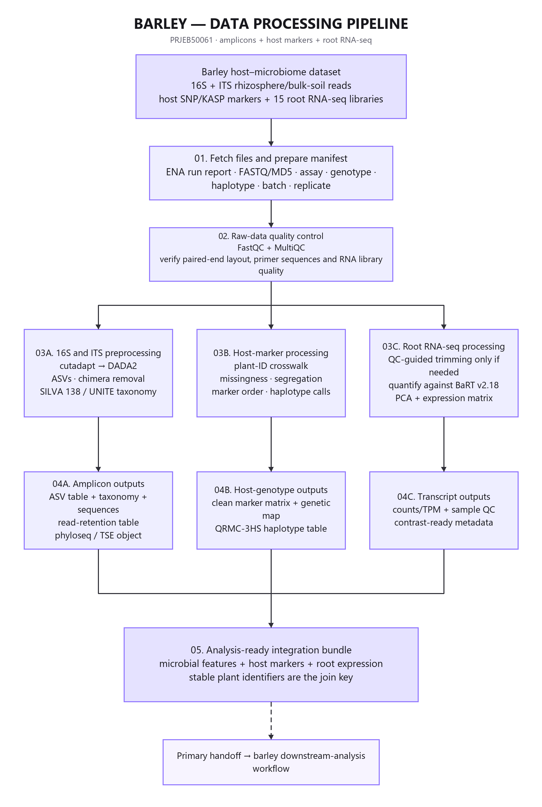
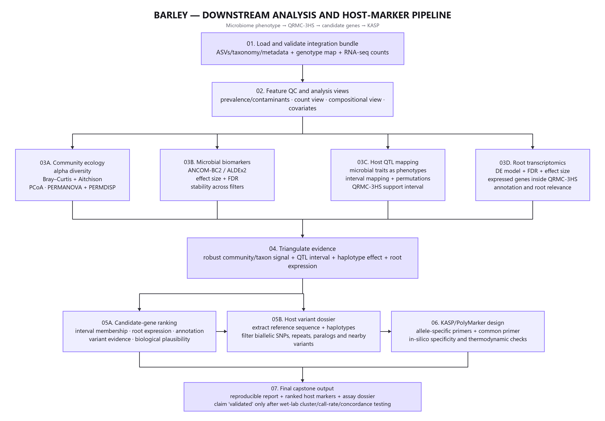

# Barley QRMC-3HS host microbiome capstone execution guide

    ## Purpose

    This guide turns Escudero-Martínez et al. (2022), Identifying plant genes shaping microbiota composition in the barley rhizosphere into a reproducible teaching workflow. The sequence follows the supplied reference scripts: raw-data processing first, ecological analysis in R second, and marker identification only after the biological evidence is defensible.

    **Paper:** [Open the primary article](https://doi.org/10.1038/s41467-022-31022-y)  
    **Public data:** PRJEB50061  
    **Validation endpoint:** A ranked QRMC-3HS host-variant dossier and an in-silico KASP or PolyMarker design. The assay remains designed, not validated, until laboratory and independent-population testing.

    ## Study design

    52 progeny genotypes plus parental and bulk-soil controls were used for bacterial microbiome mapping. Sibling lines carrying contrasting QRMC-3HS haplotypes supplied a focused validation experiment, including bacterial and fungal amplicons and 15 root RNA-seq libraries with five biological replicates per genotype.

    The publication used 515F/806R for bacterial 16S and ITS1F/ITS2 for fungal ITS on paired 2 × 150 bp MiSeq reads. Bacterial taxonomy used SILVA 138 and fungal taxonomy used UNITE 04.02.2020.

    The first analytical obligation is to reconcile the ENA or SRA run report with the paper and supplementary metadata. Public database fields may describe sequencing correctly while omitting the biological treatment, host line, plot, or block needed for inference.

    ## Complete pipeline

    

    

    ## Repository layout

    ```text
    barley/
    |-- README.md
    |-- config/
    |   |-- project.env.example
    |   `-- assays.tsv
    |-- pipeline_orchestration/               optional: automated Slurm chain + environment setup
    |   |-- load_modules.sh                   source this first on teach-sub1 (Lmod modules)
    |   |-- activate_conda_env.sh             fallback: discovers a conda env by capability
    |   |-- check_environment.sh
    |   |-- pipeline_config.yaml
    |   `-- run_pipeline_from_yaml.sh
    |-- data/
    |   |-- analysis_metadata.tsv
    |   `-- run_manifest.tsv                 created by Script 1
    |-- references/
    |-- pipeline_raw_reads_to_counts/
    |   |-- 1_Fetch_And_Verify_Raw_Reads.sh
    |   |-- 2_Interpret_FastQC_Diagnostics.sh
    |   |-- 3_Fetch_All_And_Import_To_QIIME2.sh
    |   |-- 4_Primer_Trim_And_Infer_ASVs.sh
    |   |-- 5_Classify_Taxonomy_And_Export.sh
    |   `-- 6_QC_Report_Generator.sh
    |-- analysis_metagenomics_phyloseq/
    |   |-- 00_install_packages.R
    |   |-- 01_prepare_metadata.R through 09_publication_dashboard.R
    |   `-- run_analysis.R
    |-- marker_identification/
    |-- results/
    `-- docs/
    ```

    ## Computational preparation

    Run the upstream workflow on Linux or a Linux HPC node. The active environment must expose `curl`, `md5sum`, `sha256sum`, FastQC, MultiQC, QIIME 2 with q2-cutadapt and q2-dada2, and BIOM. The tomato project additionally needs fastp, Bowtie2, Kraken2, Bracken, and Python 3. Record the exact versions actually used; software interfaces matter more than a nominal environment name.

    Two scripts under `pipeline_orchestration/` automate this rather than hand-loading each tool. On `teach-sub1`, `source load_modules.sh` is confirmed to work: it loads real, pinned Lmod modules for QIIME2 (`QIIME2/2025.10-amplicon`) and FastQC (`FastQC/0.12.1-Java-11`), and live-discovers a real MultiQC or R version otherwise (auto-selecting the highest available on the cluster, since neither has one single confirmed-working version yet — every version it did not pick is named in its output). `biom` is confirmed to ship bundled with the QIIME2 module here, not as a separate module. On a cluster without these as Lmod modules, `source activate_conda_env.sh` instead discovers a conda environment providing the same tools by capability (no environment name is pinned, since none is documented for this project). Both must be *sourced*, never executed directly, or the environment changes vanish immediately. Follow either with `bash check_environment.sh`, which also verifies the required R packages and every reference artifact named in `config/assays.tsv` — see Troubleshooting for real failures hit running this exact sequence on `teach-sub1`.

    Copy `config/project.env.example` to the ignored `config/project.env`. Set external work, raw-read, output, and reference paths if project defaults are unsuitable. Do not store raw reads or reference databases in Git.

    Place the required QIIME reference sequence and taxonomy artifacts in `references/` under the filenames declared in `config/assays.tsv`. Record release, URL, download date, and SHA-256 in `references/reference_manifest.tsv`. The pipeline stops rather than substitute an unnamed database.

    ## Raw reads to feature counts

    | Step | Script | Main decision | Required evidence before continuing |
|---:|---|---|---|
| 1 | `1_Fetch_And_Verify_Raw_Reads.sh` | Resolve public run metadata and download one pilot | Reviewed assay label, complete ENA URLs, matching deposited MD5 |
| 2 | `2_Interpret_FastQC_Diagnostics.sh` | Decide whether quality truncation is needed | MultiQC reviewed, expected amplicon length and paired overlap documented |
| 3 | `3_Fetch_All_And_Import_To_QIIME2.sh` | Freeze the included run set and separate assays | Every included row reconciled to a sample and experimental unit |
| 4 | `4_Primer_Trim_And_Infer_ASVs.sh` | Remove published primers and infer ASVs | Primer retention, denoising loss, merging, and chimera rates acceptable |
| 5 | `5_Classify_Taxonomy_And_Export.sh` | Assign taxonomy and export feature counts | Database release, artifact source, and checksums recorded |
| 6 | `6_QC_Report_Generator.sh` | Approve the upstream handoff | Sample totals, feature counts, depth, controls, and exclusions reconciled |

    Run one file at a time. Script 1 creates `data/run_manifest.tsv` and downloads a pilot. Before Script 3, reconcile every included run, assay, analysis ID, biological sample, and experimental unit. Before Script 4, review the pilot and full demultiplex summaries. A paired DADA2 setting is acceptable only when the retained forward and reverse segments still overlap the expected insert.

    Truncation defaults to zero because a defensible value depends on the observed run. For fungal ITS, variable biological length is expected; a fixed 16S truncation rule must not be copied across. If a run cannot merge after justified trimming, document the failure and use a validated single-end alternative or exclude it under a predefined rule.

    ## Metadata contract

    Required fields are `sample_id`, `analysis_id`, `run_accession`, `assay`, `experimental_unit_id`, `genotype`, `qrmc3hs_haplotype`, `compartment`, `batch`, `biological_replicate`, `control_status`. `analysis_id` must match a feature-table column. `experimental_unit_id` identifies the plant, recombinant line unit, or field plot used for inference. If multiple technical runs map to one experimental unit within an assay, merge the counts deliberately or fit a model that represents their dependence; the supplied R loader stops instead of treating them as independent replicates.

    Recommended additional fields include sample title, read count, qPCR values where available, soil measurements, processing batch, extraction plate, and notes. Missing values should be explicit `NA`, not an empty string with ambiguous meaning.

    ## Feature counts to R figures

    | Step | Script | Teaching purpose | Primary output |
|---:|---|---|---|
| 00 | `00_install_packages.R` | Restore or create an `renv` lock | Reproducible R library |
| 01 | `01_prepare_metadata.R` | Validate experimental units and covariates | `metadata_validated.tsv` |
| 02 | `02_load_biom_and_build_phyloseq.R` | Build count and taxonomy objects | `02_phyloseq_raw.rds` |
| 03 | `03_qc_filter_and_normalization.R` | Separate raw counts, proportions, CLR, and rarefaction roles | `03_analysis_objects.rds` and QC summary |
| 04 | `04_alpha_diversity.R` | Analyze within-sample diversity | Per-assay alpha table and figure |
| 05 | `05_beta_diversity.R` | Analyze community structure with dispersion checks | Bray-Curtis and Aitchison tests and PCoA |
| 06 | `06_compositionality_demo.R` | Show why relative abundance is constrained | Closure summary and figure |
| 07 | Study-specific result script | Reproduce the study's central biological handoff | Study-specific table and figure |
| 08 | `08_differential_abundance_aldex2.R` | Use a CLR-based count method for a declared contrast | ALDEx2 result table |
| 09 | `09_publication_dashboard.R` | Assemble figures and capture provenance | Dashboard, session information, and input hashes |

    Install packages once, inspect the resulting `renv.lock`, and commit the lockfile. The analysis runner sources Scripts 01 through 09 in one session so that each named object becomes the input to the next lesson.

    The pipeline preserves three data views for different questions. Raw counts enter ALDEx2. Proportions support descriptive composition plots. CLR coordinates support Aitchison distances after a declared pseudocount. Rarefaction appears only in the alpha-diversity sensitivity analysis and is not reused for differential abundance.

    ## Statistical model

    For the focused microbiome comparison, model QRMC-3HS haplotype with batch retained as a covariate. Restrict permutations within batch. The broader QTL reconstruction requires the verified barley marker map and should not be inferred from sample labels.

    Each beta-diversity analysis includes Bray-Curtis, an Aitchison sensitivity view, PERMANOVA, and PERMDISP. Report both the location and dispersion results. A significant PERMANOVA with heterogeneous dispersion requires cautious interpretation. Differential-abundance tables must report effect estimates and false-discovery-rate-adjusted values, including the absence of discoveries when power is limited.

    ## Study-specific result

    `07_qrmc3hs_showcase.R` tests whether rhizosphere bacterial community structure differs between reviewed wild-like and elite-like haplotype groups. It also tests multivariate dispersion. It does not label the locus causal or select one causal taxon.

    ## Marker identification

    The marker dossier must name the barley reference assembly or transcript reference, chromosome and coordinate, alleles, QRMC-3HS interval evidence, nearby variants, repeats, paralogs, and at least 50–100 bp of flanking sequence on each side. EasyKASP or PolyMarker output should include two allele-specific forward concepts and one common primer concept. Laboratory cluster separation, call rate, concordance, and independent germplasm testing are future work.

    Use `marker_identification/marker_evidence_template.tsv` as an audit trail. Rejected candidates are scientifically useful when the reason is recorded. Never route a microbial abundance feature into KASP; KASP genotypes a biallelic host DNA variant.

    ## Quality review checklist

    - The final included-run count agrees with the manifest and paper-defined scope.
    - Every FASTQ has a verified deposited MD5 and every exported handoff has a recorded SHA-256.
    - Primer sequences and reference releases are named in machine-readable configuration.
    - Read retention is checked after primer removal, filtering, denoising, merging, and chimera removal.
    - Negative and positive controls are identified where the public metadata provide them.
    - Organellar and non-target features are removed without discarding unlabeled taxa silently.
    - Biological and technical replicates are distinguished.
    - Model contrasts, block restrictions, prevalence rules, pseudocount, and random seed are recorded.
    - Relative abundance, qPCR load, predicted function, host association, assay design, and experimental validation use different language.
    - The dashboard can be regenerated from the committed scripts and documented external inputs.

    ## Minimum complete project

    Complete both amplicon branches when resources allow, reproduce the focused QRMC-3HS community association, integrate author-provided QTL and RNA-seq evidence, and submit one accepted or transparently rejected host-marker candidate.

    A minimum project may use a reviewed subset when full download or computation is infeasible, but the subset rule must be chosen before results are inspected and must preserve the relevant treatments, blocks, and controls.

    ## Troubleshooting

    **`activate_conda_env.sh` reports `conda is not on PATH`.** Expected on `teach-sub1` specifically: this cluster provides QIIME2, FastQC, MultiQC, and R as real Lmod modules, not conda. Try `source load_modules.sh` first; combine the two scripts only if `load_modules.sh` alone still leaves something `check_environment.sh` reports missing.

    **`load_modules.sh` reports multiple real versions for MultiQC or R and auto-selects the highest.** Deliberate, not a failure. Neither tool has one single confirmed-working version yet, so the script picks the newest real version available on the cluster and loads it, always naming every version it did not pick. A wrong pick is not silent: MultiQC's own report output would simply look different, and any R-package incompatibility is caught explicitly by `check_environment.sh`'s own required-package check below. Pin a specific version inside the script instead once one is confirmed to work best for this pipeline.

    **`Rscript analysis_metagenomics_phyloseq/00_install_packages.R` returns instantly with no output, and `check_environment.sh` still reports the exact same missing R packages afterward.** The script's `manage_packages()` function must actually be invoked at the top level; confirm the file ends with `if (!interactive()) manage_packages(mode = "automatic")`. Without that call, `Rscript` only defines the function and exits having installed nothing — a real bug found and fixed on 2026-09, present identically in all three sibling projects (barley, tiftuf, tomato) until then.

    **`install.packages("renv")` fails: `'lib = ".../lib64/R/library"' is not writable`.** A module-provided R on shared HPC installs into an admin-owned system library a regular user can never write to; an interactive R session would prompt to create a personal one, but non-interactive `Rscript` can't show that prompt. Confirm `00_install_packages.R` calls `ensure_install_environment()` at the top of `manage_packages()` (it resolves or creates a personal `R_LIBS_USER` library automatically) — or set one yourself before running the script: `export R_LIBS_USER=~/R/library; mkdir -p "$R_LIBS_USER"`.

    **`install.packages()` fails: `trying to use CRAN without setting a mirror`.** A fresh non-interactive `Rscript` session has no default CRAN mirror configured; interactive R would prompt a picker list, which `Rscript` cannot show. Confirm `ensure_install_environment()` sets `options(repos = c(CRAN = "https://cloud.r-project.org"))`, or set it yourself first if running commands by hand.

    **No assay is included after Script 1.** Review `sample_title`, `experiment_title`, and `library_name` in the ENA report. Resolve `REVIEW_REQUIRED` manually; do not weaken the classifier until unrelated libraries enter the project.

    **DADA2 loses most reads.** Confirm the primer orientation, inspect forward and reverse quality independently, calculate remaining overlap, and examine whether different sequencing runs require separate error models. Do not raise error thresholds only to increase yield.

    **Taxonomy artifacts are missing or incompatible.** Obtain the declared release in a format compatible with the installed QIIME 2 distribution, record the provenance, and rerun. Do not rename a different release to satisfy the file check.

    **Few ALDEx2 features pass FDR.** Report effect sizes, uncertainty, sample size, and power limitations. Do not replace the method with uncorrected tests to manufacture a positive result.

    **The selected marker cannot be designed specifically.** Reject it, document nearby variants, repeats, paralogs, or taxonomic cross-reactivity, and evaluate a prespecified backup candidate.

    ## Primary references

    1. Escudero-Martínez et al. (2022), Identifying plant genes shaping microbiota composition in the barley rhizosphere. [Primary article](https://doi.org/10.1038/s41467-022-31022-y)
    2. Callahan BJ et al. 2016. DADA2 high-resolution sample inference from Illumina amplicon data. [DADA2 paper](https://doi.org/10.1038/nmeth.3869)
    3. Fernandes AD et al. 2014. Unifying the analysis of high-throughput sequencing datasets with ALDEx2. [ALDEx2 paper](https://doi.org/10.1186/2049-2618-2-15)
