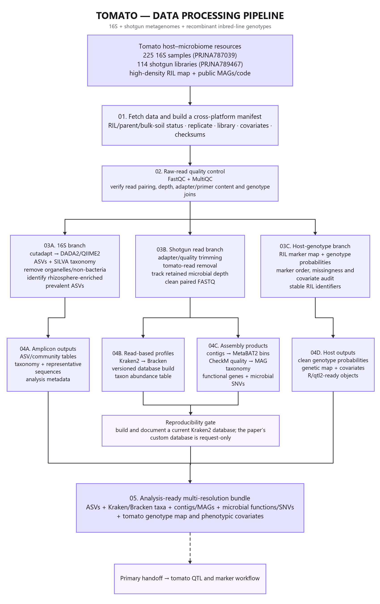
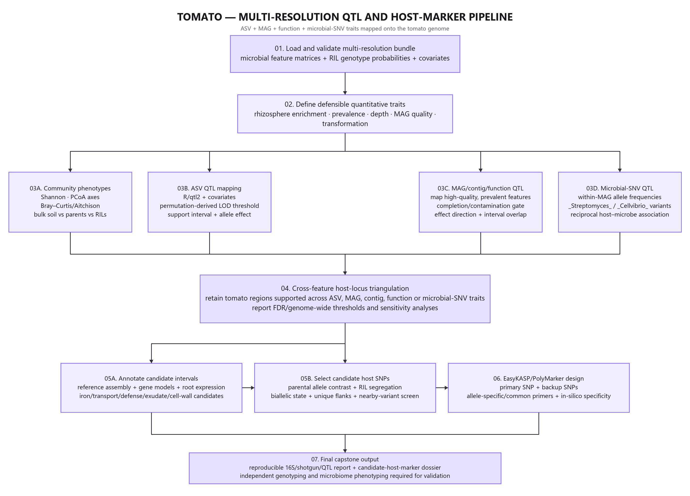

# Tomato multi-resolution host microbiome capstone

**Study:** Oyserman et al. (2022), Disentangling the genetic basis of rhizosphere microbiome assembly in tomato  
**Primary source:** [https://doi.org/10.1038/s41467-022-30849-9](https://doi.org/10.1038/s41467-022-30849-9)  
**Public sequence project:** PRJNA787039, PRJNA789467  
**Implemented read branches:** 16S, shotgun

The core scripts process 16S reads to ASV counts and shotgun reads through adapter trimming, tomato-host depletion, Kraken2, and Bracken. Full co-assembly and MAG reconstruction remain an HPC extension; public MAGs can be integrated without pretending they were rebuilt locally.



## Pipeline contract

Scripts 1 through 6 create feature counts. R Scripts 01 through 09 consume only the exported counts, taxonomy, representative sequences, and a reviewed `data/analysis_metadata.tsv`. Execute files in numerical order. Script 00 installs or verifies R packages and is not sourced automatically during a production run.

```bash
cp config/project.env.example config/project.env
# edit paths and resource settings
bash pipeline_raw_reads_to_counts/1_Fetch_And_Verify_Raw_Reads.sh
# review data/run_manifest.tsv and the pilot FastQC report
bash pipeline_raw_reads_to_counts/2_Interpret_FastQC_Diagnostics.sh
bash pipeline_raw_reads_to_counts/3_Fetch_All_And_Import_To_QIIME2.sh
bash pipeline_raw_reads_to_counts/4_Primer_Trim_And_Infer_ASVs.sh
bash pipeline_raw_reads_to_counts/5_Classify_Taxonomy_And_Export.sh
bash pipeline_raw_reads_to_counts/6_QC_Report_Generator.sh

Rscript -e 'source("analysis_metagenomics_phyloseq/00_install_packages.R"); manage_packages("automatic")'
Rscript analysis_metagenomics_phyloseq/run_analysis.R
```

On Slurm, submit each upstream script only after the preceding quality gate passes. The scripts also run directly in an activated Linux environment. Site-specific `module load` commands are intentionally excluded because module names differ among clusters.

## Metadata gate

Complete one row per analysis unit in `data/analysis_metadata.tsv`. Required fields are `sample_id`, `analysis_id`, `run_accession`, `assay`, `experimental_unit_id`, `host_group`, `ril_id`, `compartment`, `harvest_batch`, `biological_replicate`, `control_status`. Use `experimental_unit_id` to distinguish the plant, RIL, or field plot from a run or PCR library. Technical runs must not be counted as independent biological replicates.

Script 1 creates `data/run_manifest.tsv` from ENA. Its assay classifier is only a review aid. Any `REVIEW_REQUIRED` value must be resolved against the paper, supplements, and public repository before the row can be included.

## Reproducibility-critical changes from the reference skeleton

- All paths are project-relative or configured; no username or cluster scratch path is embedded.
- ENA-provided MD5 checksums are verified for every FASTQ, and exported products receive SHA-256 hashes.
- 16S, ITS, and shotgun files cannot enter the wrong processing branch.
- Published primers are visible in `config/assays.tsv`; truncation is left at zero until observed quality and overlap justify a change.
- Taxonomy references, a tomato host index, and any Kraken2 database are explicit versioned inputs.
- PERMANOVA is paired with PERMDISP, block variables are retained, and ALDEx2 uses raw counts rather than relative abundance.
- Every final dashboard records `sessionInfo()` and input provenance.

## Expected handoff to R

Amplicon outputs appear under `pipeline_raw_reads_to_counts_output/exported/<assay>/`. Each contains `feature-table-with-taxonomy.biom`, `taxonomy.tsv`, and `dna-sequences.fasta`. Tomato shotgun outputs appear under `exported/shotgun/` as a Bracken count matrix and taxonomy table.

## Study-specific endpoint

A cross-resolution microbial feature linked to a tomato QTL, followed by a candidate host SNP and an in-silico KASP or PolyMarker design.



The illustrated execution guide is supplied as [Markdown](docs/tomato_execution_guide.md), Word, and PDF in `docs/`. Also see the [marker evidence template](marker_identification/marker_evidence_template.tsv) and the [master portfolio](../../docs/master/plant_microbiome_capstone_master_document.md).
